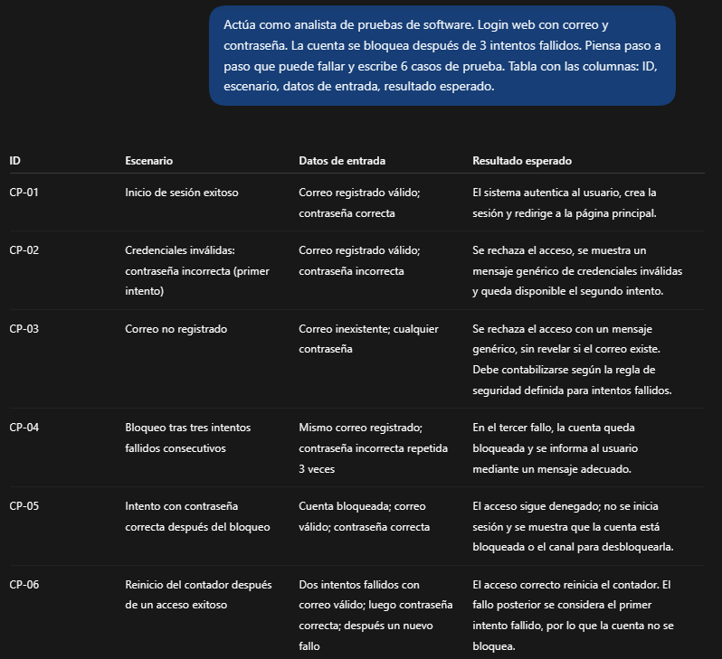
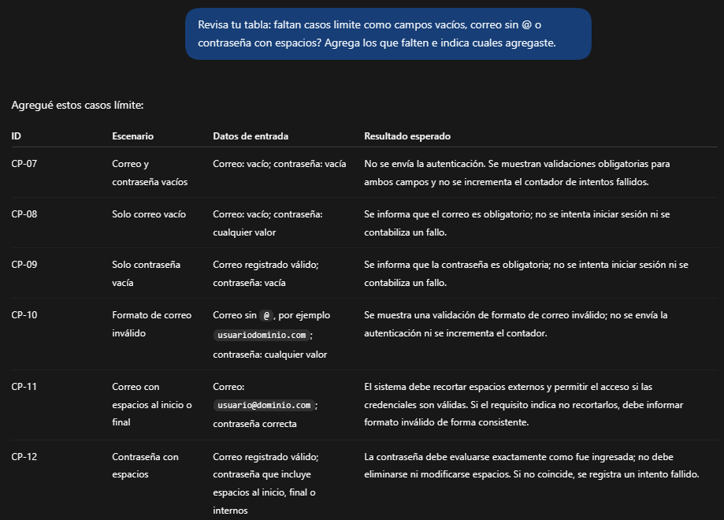

# Bitacora de tecnicas avanzadas

Laboratorio 07: Tecnicas Avanzadas de Prompting.

Herramienta de IA usada: ChatGPT

## Ejercicio 2: Zero-shot, one-shot y few-shot

| Tipo | Aciertos (de 5) | Formato de la respuesta | Todas con el mismo formato (Si/No) |
|------|-----------------|-------------------------|------------------------------------|
| Zero-shot | Si | Lista con valores Positivo, Neutral y Negativo. | Si |
| One-shot | Si | Lista con valores Positivo, Neutral y Negativo. | Si |
| Few-shot | Si | Asignado con valores Positivo, Neutral y Negativo | Si |

## Ejercicio 3: Chain of Thought

| Pedido | Respuesta de la IA | Muestra los pasos (Si/No) | Correcta (Si/No) |
|--------|--------------------|---------------------------|------------------|
| Directo | 318.60 | No | Si |
| Paso a paso | 318.60 (con resolución paso a paso) | Si | Si |


## Ejercicio 4: Role prompting

| Version | Vocabulario (sencillo/tecnico) | Usa ejemplos o codigo | A quien le sirve mas |
|---------|-------------------------------|-----------------------|----------------------|
| A. Sin rol | Sencillo | Si | Público general |
| B. Rol docente | Técnico | Si | Estudiantil |
| C. Rol senior | Técnico | Si | Profesional |


## Ejercicio 5: Descomposicion

````
Prompt Simple:

"Crea un sistema de inventario para una tienda."
````


> Resultado: La IA ha generado un sistema de inventario web donde permite registar, filtrar y eliminar productos, pero las demás funcionalidades no funcionan.

````
Descomposición de prompt:

Paso 1: Voy a crear un sistema de inventario para una tienda pequeña en Java. Lista los 5 requisitos principales del sistema.
Paso 2: Con esos requisitos, diseña las clases necesarias. Para cada clase indica sus atributos con su tipo de dato.
Paso 3: Escribe el codigo Java de la clase Producto con sus atributos, un constructor y los metodos get y set.
Paso 4: Revisa el codigo de la clase Producto y propone 3 mejoras concretas.
````

> Resultado: La IA responde paso a paso cada instrucción que le brindramos; 5 requisitos, las clases y sus atributos, el codigo en java y la revisión final con 3 propuestas para mejorar el código.

## Ejercicio 6: Prompt estructurado y autocritica

```text
Prompt Estructurado: 

"Actúa como analista de pruebas de software. Login web con correo y contraseña. La cuenta se bloquea después de 3 intentos fallidos. Piensa paso a paso que puede fallar y escribe 6 casos de prueba. Tabla con las columnas: ID, escenario, datos de entrada, resultado esperado."
```


```text
Autocrítica:

"Revisa tu tabla: faltan casos limite como campos vacíos, correo sin @ o contraseña con espacios? Agrega los que falten e indica cuales agregaste."
```



| Revisión | ¿Cumple?|
|---------|--------------------------------|
| ¿Tiene las 4 columnas pedidas? | Si |
| ¿Incluye el bloqueo después de 3 intentos? | Si |
| ¿Incluye casos con campos vacíos? | Si |
| ¿Indica qué casos agregó en la autocrítica? | Si |
| ¿Hay algún caso repetido o que no tenga sentido? | No |